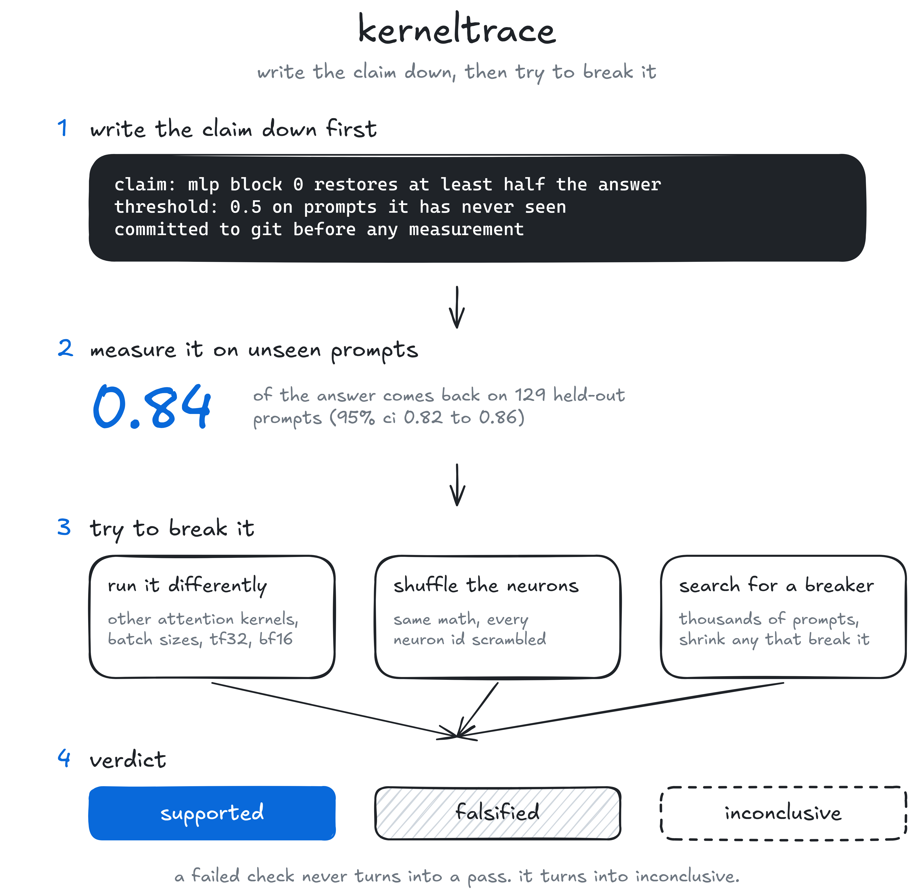
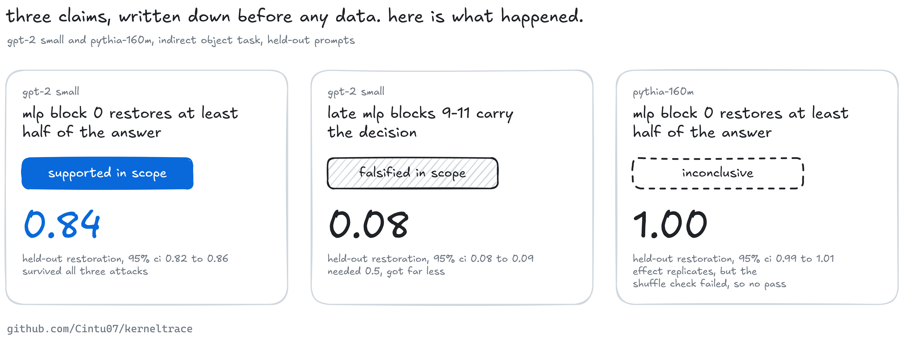
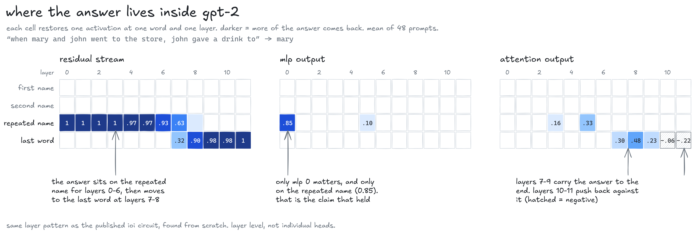
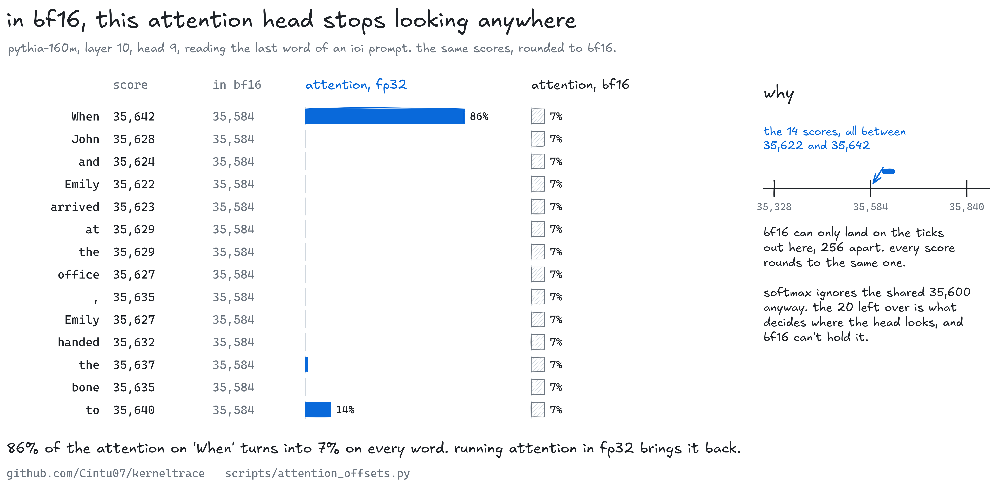
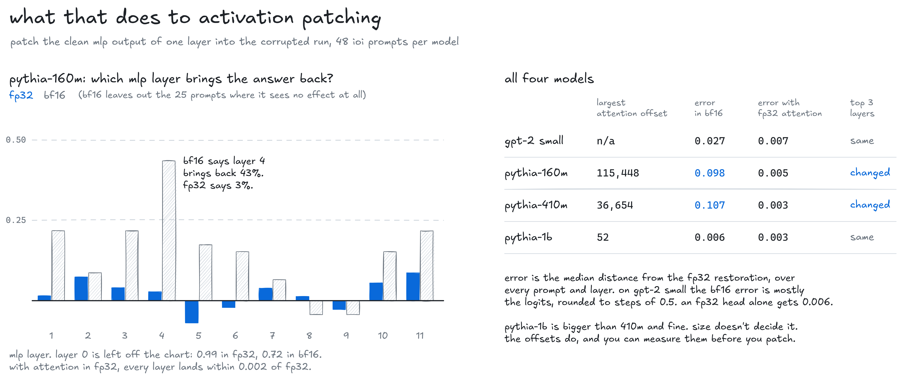
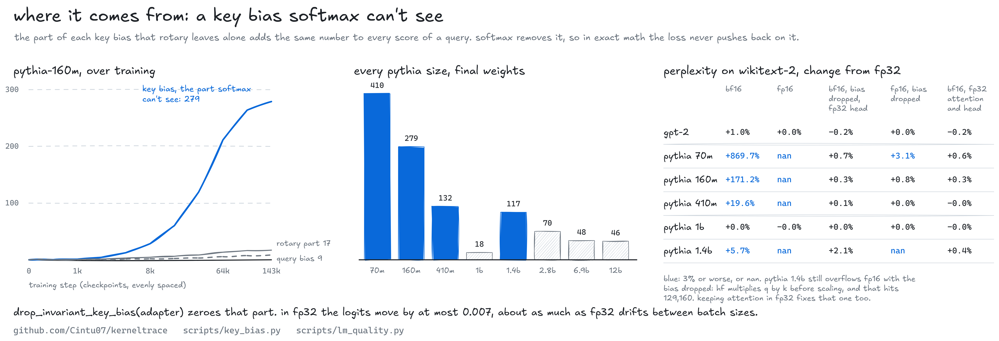
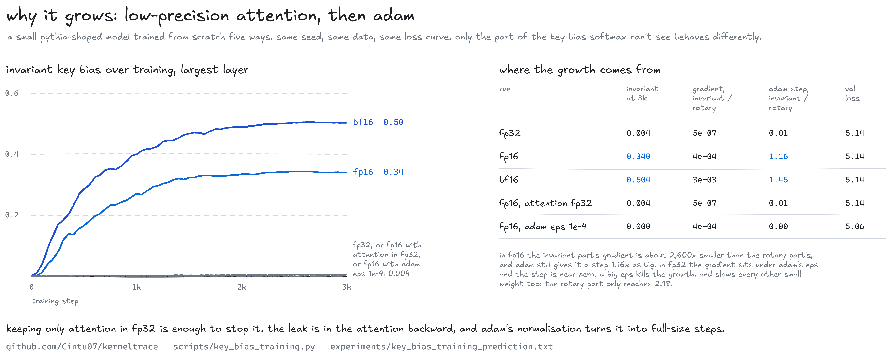
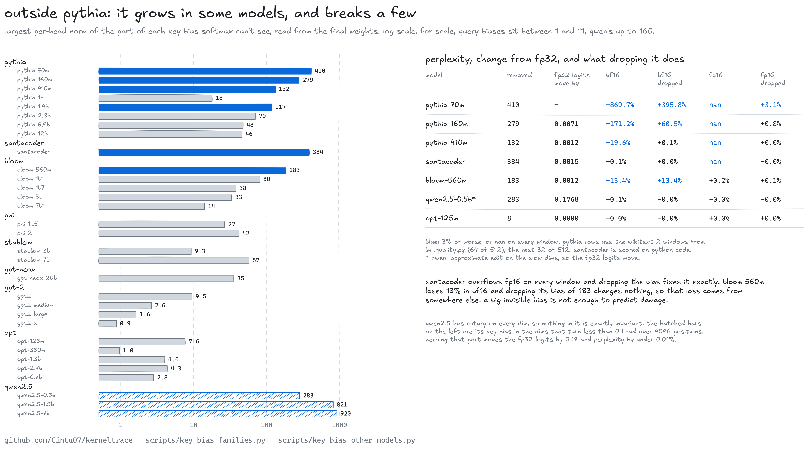

# kerneltrace



most interpretability results come from one experiment. you patch an activation, a heatmap lights up, and the story gets written down as "this component does x". nobody goes back and tries to break it.

kerneltrace is the thing that tries. you write a claim down first, with numbers, and commit it before you measure anything. then it gets measured on prompts it has never seen and attacked three ways. it reruns the model on other attention kernels, batch sizes, tf32 and bf16, and the profiler checks which kernel actually ran. it shuffles every mlp neuron in a way that keeps the math identical. and it searches thousands of prompts for one that breaks the claim, then shrinks that prompt down to the smallest change that still breaks it.

a claim comes out supported, falsified or inconclusive. if any check fails along the way, it lands on inconclusive. everything ends up in an evidence bundle with a hash for every file, so you can replay it.

## what came out

three claims, gpt-2 small and pythia-160m, the indirect object task, one laptop gpu.



the gpt-2 claim that mlp block 0 restores at least half the answer held up. 0.84 on held-out prompts, and 13,500 forward passes of counterexample search found nothing. the claim that the last three mlp blocks carry the decision got 0.084 against a promised 0.5, so it's falsified. on pythia the mlp 0 effect replicates at 0.997, but the neuron shuffle drifted past its parity check, so it stays inconclusive. that drift turned out to be the same size as running the untouched model at a different batch size. the check needs a measured noise floor. a fixed number can't tell those apart, and that's the next fix.

the causal trace shows where the answer lives. restore one activation at one word and one layer at a time, and it sits on the repeated name for seven layers, then moves to the last word at layers 7 and 8. mlp 0 matters on that one word and nowhere else.



at fp32, swapping attention kernels or batch size moved the measurements by 2e-4 logits at most. bf16 changed which blocks rank top three, and 31% of the trace cells moved by 0.05 or more from rounding alone.

## bf16 can decide what patching tells you

that last result got its own audit. four models, 48 ioi prompts each, and the same mlp patching sweep run in fp32, in bf16, in bf16 with only the unembedding in fp32, and in bf16 with attention and the unembedding in fp32. fp32 is the reference.



pythia-160m is the bad one. on 25 of the 48 prompts the clean and corrupted logit diffs come out identical in bf16, so there's no effect left to patch. its answer logits sit near 836, and bf16 only has values every 4 out there. on the prompts that survive, bf16 says mlp layer 4 brings back 43% of the answer. fp32 says 3%.

an fp32 head doesn't save it. the damage is inside attention. from layer 3 on, pythia-160m adds a huge offset to every attention score of a query, the same for every key, up to 115,448 in layer 11. softmax subtracts it back out, so in exact math it does nothing. but the part that's left, the spread between keys that decides where a head looks, is 20 to 100. bf16 steps by 256 or 512 at that size. in the head above, every score rounds to 35,584 and attention that was 86% on one word turns into 7% on all of them.



running attention in fp32 and the rest in bf16 fixes it on all four models. median error drops to 0.003 to 0.007, and the top 3 layers match fp32 on every pythia model. on gpt-2 the third place swaps between layers 9 and 11, which tie at 0.031 in fp32 anyway. pythia-410m has the same offsets (up to 36,654) and loses its layer 5 effect in bf16. pythia-1b doesn't have them (largest is 52) and bf16 is fine there, so it isn't about size. `scripts/attention_offsets.py` measures the offsets before you run anything. gpt-2 small has a smaller problem in its logits, which bf16 rounds to steps of 0.5, and an fp32 head alone handles that.

```python
from kerneltrace.models.precision import upcast_attention
adapter = upcast_attention(load(model_id, revision, "eager", "bfloat16", "cuda"))
logits, _ = run(adapter, ids, patches=..., fp32_logits=True)
```

the predictions were written down and committed before the run, in `experiments/bf16_audit_prediction.txt`. two held and four didn't. fp32 wasn't perfectly batch-stable on pythia-160m, which drifts by up to 0.007 because its logits are so big. gpt-2 jumped by 0.5 on 10 prompts, short of the quarter i guessed. pythia's jumps weren't bigger either. on most prompts neither model moved, and fewer pythia-160m prompts jumped than gpt-2 prompts, 5 against 12, because a grid of 4 swallows small drift and then lets go by 4 or 8. and the fp32 head alone didn't fix pythia, because the problem was never the head.

## where the offsets come from

the key bias. in the dimensions rotary embeddings leave alone, a head's key bias adds q · b to the score of every key a query can see, the same number for every key. softmax subtracts it, so it changes nothing, and in exact math it gets no gradient. in pythia-160m it starts at zero and grows to a norm of 279 over training. the part rotary does touch, which the loss can see, stays under 20. reading the final weights of the whole pythia suite with range requests, 70m, 160m, 410m and 1.4b all carry one over 100.



## why it grows

the cerebras-gpt paper (2023, appendix a.2) already noticed key biases growing fast in fp16 training and blamed underflow in the softmax gradients. it didn't test that. so i trained a small pythia-shaped model from scratch, 4 layers with rotary on a quarter of each head, the same seed and data every time, and changed only the precision or the optimizer.



in fp32 the invariant part of the key bias ends at 0.004 after 3,000 steps. in fp16 it's 0.340, and in bf16 0.504. the loss curves of the three runs are the same to three decimals, so the models learn the same thing. the difference is all in the part softmax can't see.

the gradient explains it. the invariant part's gradient is the row sum of the softmax score gradient times q, and that sum is zero in exact math. in fp16 the score gradient gets cast down before the matmul, the sum stops being zero, and the invariant part gets a gradient about 2,600 times smaller than the rotary part's. adam divides each step by the gradient's own recent size, so that tiny gradient gets a step 1.16 times as big as the rotary part's. in fp32 the gradient is another 800 times smaller, it sits under adam's eps of 1e-8, and the step comes out near zero.

two controls pin it down. fp16 everywhere except attention, which runs in fp32, ends at 0.004, the same as full fp32. so the leak is in the attention backward. adam with eps 1e-4 in fp16 ends at 0.000, but it also slows every other small weight, and the rotary part only reaches 2.18 instead of 4.04. the run doesn't show where the sign of the leak comes from, or how far it would have gone over pythia's 143,000 steps.

nine predictions, in `experiments/key_bias_training_prediction.txt`, the ninth added before its run. seven held. the invariant part never got bigger than the rotary part in 3,000 steps (0.34 against 4.04), and i'd guessed it would be twice as big. the fp16 gradient ratio was 4e-4, not above 1e-2. the sgd run moved no bias at all, rotary part included, so it says nothing about adam and the eps run carries that instead.

## outside pythia

any model with a key bias has the invariant part. with learned positions or alibi it's the whole key bias, with partial rotary it's the dims rotary skips. `scripts/key_bias_families.py` reads it out of 23 checkpoints from eight families the same way as the pythia suite, bias tensors only.



it grows in some of them. santacoder's is 384 and bloom-560m's 183, against query biases of 7 and 11. the rest of bloom, phi, stablelm-7b and gpt-neox-20b sit between 14 and 80. gpt-2 and opt stay under 10, and gpt-2 medium, large and xl are below their own query bias, so it isn't something every model does.

qwen2.5 has rotary on every dim, so none of its key bias is exactly invariant. but its rotary base is a million, and its slowest dims turn less than a tenth of a radian over 4,096 positions. that's where its key bias sits, 283 in 0.5b, 821 in 1.5b and 920 in 7b, against 35 to 120 in all the other dims. zeroing it there moves the fp32 logits by 0.18 and the perplexity by under 0.01%.

big doesn't mean broken. `scripts/key_bias_other_models.py` runs perplexity with and without it. santacoder gives nan on every window in fp16, and with the invariant part dropped fp16 matches fp32. that edit moves the fp32 logits by 0.0015. but its bf16 is only 0.1% off. bloom-560m loses 13.4% in bf16 and dropping its 183 changes nothing, so its problem is somewhere else. qwen and opt are fine in both.

twelve predictions in `experiments/key_bias_families_prediction.txt`, five held. i expected the growth to be more common and to do more damage than it does. opt, bloom-7b1, gpt-neox-20b and qwen-1.5b all came in under what i guessed, santacoder broke in fp16 and not bf16, bloom's bf16 loss wasn't the bias, and qwen didn't overflow fp16. cerebras-gpt is gated now and wasn't checked.

it reaches past patching. on wikitext-2, pythia-70m's perplexity goes from 68 to 659 in bf16. 160m gets 171% worse, 410m 20%, 1.4b almost 6%. in fp16, 70m, 160m, 410m and 1.4b give nan on every window.

zeroing that part of the bias is an exact edit, `drop_invariant_key_bias(adapter)`. in fp32 the logits move by at most 0.007. after it, pythia-410m runs in plain bf16 within 0.1% of fp32 and its patching sweep matches fp32, and fp16 is finite again on 70m, 160m and 410m. it doesn't cover everything. 70m and 160m also need the fp32 head, because their output logits are huge. 1.4b still overflows fp16, because hf multiplies q by k before scaling and that product hits 129,160 even without the bias. keeping attention and the head in fp32 handles every case here, within 0.6% of fp32 perplexity on all six models.

the predictions for this part are in `experiments/key_bias_prediction.txt`, each batch committed before it ran. six held and three didn't. plain bf16 with the bias dropped wasn't enough for pythia-160m's patching sweep (median error 0.051, i'd said 0.02). the 25 prompts where bf16 saw no effect came back with the bias alone, when i'd guessed the output grid would keep more than 10 of them lost. and dropping the bias left 160m's bf16 perplexity 60% off instead of within 0.5%, which is how the second problem, its huge output logits, showed up.

## run it

```bash
pip install torch --index-url https://download.pytorch.org/whl/cu128   # pick the build for your gpu
pip install -e ".[dev]"
pytest -q                                          # 71 tests, cpu only, no downloads
kerneltrace run experiments/gpt2_ioi_mlp0.yaml     # about 6 minutes on an 8 gb laptop gpu
kerneltrace replay evidence/<bundle>               # rerun a bundle and compare it to what was stored
python scripts/causal_trace.py 24                  # the traces behind the picture above
python scripts/bf16_batch_check.py                 # one prompt, two batch sizes, the 0.5 jump
python scripts/bf16_audit.py && python scripts/bf16_summary.py   # the bf16 audit, about 15 minutes
python scripts/key_bias.py                         # parity of the bias edit, training checkpoints, the whole suite
python scripts/lm_quality.py                       # wikitext-2 perplexity in fp32, bf16 and fp16
python scripts/key_bias_training.py && python scripts/key_bias_training_summary.py   # train it six ways, about 30 minutes
python scripts/key_bias_families.py                # the invariant key bias in 23 checkpoints outside pythia
python scripts/key_bias_other_models.py            # perplexity with and without it, santacoder, bloom, qwen, opt
```

a run writes a folder under `runs/`. inside is the manifest (model commit, library and driver versions, gpu, tf32 and determinism switches, git state), the claim with its final status, every generated prompt with the reason any were rejected, raw per-case results, the kernels the profiler saw, and a report.

## what's in here

`kerneltrace/` is the library: claim cards, the ioi task, gpt-2 and pythia adapters, patching, the three attacks, the stats and the verdict rules. `experiments/` has the claim cards and the specs that test them. `evidence/` holds the bundles from the runs above. `scripts/` draws the figures and computes the causal traces.

the status rules live in `kerneltrace/core/verdict.py`. short version: a failed gate means inconclusive. an interval on the wrong side of its threshold means falsified. an untested invariance means inconclusive. a valid attack that changes a decision means challenged.

some limits. one task family, mlp blocks only, small models. the claim cards use two, the bf16 audit goes up to pythia-1b, perplexity up to 1.4b, and the bias survey reads pythia up to 12b and 23 other checkpoints up to 20b without running them. attention heads, where this task actually lives, come next. the windows pytorch wheel ships without flash attention, so that kernel shows up as not run on windows. and none of this says anything about model safety.

mit license.
