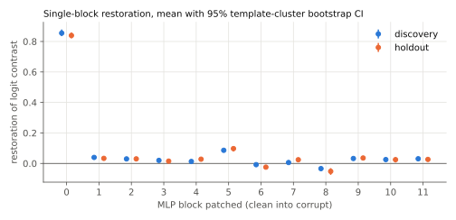
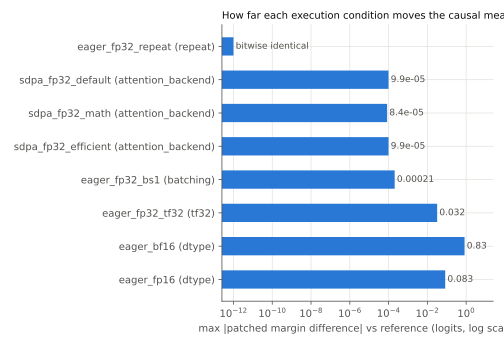
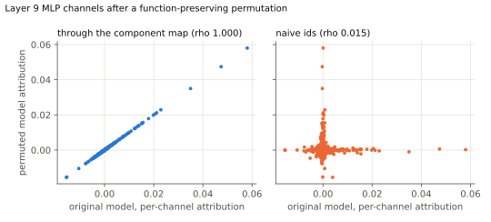
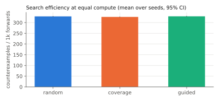

# Evidence report: `gpt2_ioi_late_mlp_decision_v1`

**Status: `falsified_in_scope`**

- prediction mean_restoration failed: mean restoration CI [0.076, 0.092] < 0.5
- prediction per_case_restoration failed: 128/129 cases below 0.25; rate CI low 0.957 > 0.1

> In GPT-2 small on IOI with an S2-flip corruption, the late MLP blocks 9, 10 and 11 jointly carry the indirect-object decision: restoring their clean outputs restores at least half of the logit contrast.

Mechanism: Late MLPs write the answer-name direction into the residual stream at the final position.  
Unit: MLP block outputs 9, 10, 11 (all positions, patched jointly)  
Model: `openai-community/gpt2` @ `607a30d783dfa663caf39e06633721c8d4cfcd7e`  
Scope: 16 registered IOI templates (8 discovery, 8 holdout), 40 single-token first names split 30/10, 12 places, 10 objects, both name orders (float32, backends eager, sdpa)

## Smallest contradicting experiment

Prediction `per_case_restoration` requires patching MLP blocks [9, 10, 11] to restore at least 0.25 of the contrast on every valid input. The base input, the first point of the search space with nothing varied, is already valid and already fails it, so no shrinking is needed:

```text
clean:    When Mary and John went to the store, John gave a drink to
corrupt:  When Mary and John went to the store, Mary gave a drink to
clean margin +2.006   corrupt margin -1.789   patched margin -1.230   restoration 0.147
```

Search found 4432 distinct counterexamples, 4432 of which reproduced on a fresh evaluation (`counterexamples.jsonl`).

## Predictions

| id | kind | split | outcome | evidence |
|---|---|---|---|---|
| mean_restoration | restoration_at_least | holdout | **fail** | mean restoration CI [0.076, 0.092] < 0.5 |
| positive_effect | effect_positive | holdout | **pass** | mean effect CI low 0.4213 > 0 |
| per_case_restoration | restoration_at_least | holdout | **fail** | 128/129 cases below 0.25; rate CI low 0.957 > 0.1 |

## Gates

| gate | ok | detail |
|---|---|---|
| model_revision_pinned | True | revision '607a30d783dfa663caf39e06633721c8d4cfcd7e', loaded commit '607a30d783dfa663caf39e06633721c8d4cfcd7e' |
| reference_dispatch_verified | True | ok |
| task_validity | True | valid cases per split {'discovery': 160, 'holdout': 129}, need 30 |
| identity_patch_null | True | max \|identity patch - corrupt\| = 0 |

## Denominator

| split | generated | valid | rejections (a case can have several) |
|---|---|---|---|
| discovery | 160 | 160 | none |
| holdout | 160 | 129 | clean_does_not_prefer_answer: 13, contrast_below_threshold: 12, corrupt_does_not_prefer_distractor: 18 |

## Baseline: single-block MLP patching



| split | layer | mean restoration | 95% CI | mean effect (logits) | n | templates |
|---|---|---|---|---|---|---|
| discovery | 0 | 0.855 | [0.835, 0.878] | 5.517 | 160 | 8 |
| discovery | 1 | 0.039 | [0.037, 0.043] | 0.247 | 160 | 8 |
| discovery | 2 | 0.030 | [0.024, 0.036] | 0.178 | 160 | 8 |
| discovery | 3 | 0.020 | [0.015, 0.026] | 0.135 | 160 | 8 |
| discovery | 4 | 0.013 | [0.006, 0.021] | 0.071 | 160 | 8 |
| discovery | 5 | 0.086 | [0.077, 0.094] | 0.560 | 160 | 8 |
| discovery | 6 | -0.008 | [-0.015, -0.001] | -0.062 | 160 | 8 |
| discovery | 7 | 0.006 | [-0.006, 0.018] | 0.067 | 160 | 8 |
| discovery | 8 | -0.034 | [-0.047, -0.021] | -0.185 | 160 | 8 |
| discovery | 9 | 0.032 | [0.024, 0.041] | 0.220 | 160 | 8 |
| discovery | 10 | 0.025 | [0.018, 0.033] | 0.192 | 160 | 8 |
| discovery | 11 | 0.031 | [0.025, 0.038] | 0.210 | 160 | 8 |
| holdout | 0 | 0.839 | [0.820, 0.859] | 5.134 | 129 | 8 |
| holdout | 1 | 0.033 | [0.023, 0.044] | 0.193 | 129 | 8 |
| holdout | 2 | 0.030 | [0.020, 0.042] | 0.168 | 129 | 8 |
| holdout | 3 | 0.015 | [0.003, 0.027] | 0.099 | 129 | 8 |
| holdout | 4 | 0.028 | [0.022, 0.035] | 0.167 | 129 | 8 |
| holdout | 5 | 0.097 | [0.079, 0.112] | 0.590 | 129 | 8 |
| holdout | 6 | -0.024 | [-0.034, -0.012] | -0.139 | 129 | 8 |
| holdout | 7 | 0.024 | [0.012, 0.034] | 0.169 | 129 | 8 |
| holdout | 8 | -0.052 | [-0.075, -0.031] | -0.285 | 129 | 8 |
| holdout | 9 | 0.036 | [0.031, 0.039] | 0.240 | 129 | 8 |
| holdout | 10 | 0.025 | [0.006, 0.038] | 0.176 | 129 | 8 |
| holdout | 11 | 0.026 | [0.017, 0.037] | 0.167 | 129 | 8 |

### Controls

- Identity patch (corrupt activation into corrupt run): max deviation 0.000 logits.
- Top-3 blocks selected on discovery: [0, 1, 5]. Held-out joint restoration 0.861 [0.843, 0.876], above 100% of 20 random same-size block sets.
- Claimed blocks [9, 10, 11] on discovery: mean restoration 0.093 vs random same-size sets mean 0.265, max 0.870 (n=20).
- Claimed blocks [9, 10, 11] on holdout: mean restoration 0.084 vs random same-size sets mean 0.259, max 0.857 (n=20).

## Challenge: numerical execution

Every condition changes one factor relative to the reference. Measurements use the reference's set of valid cases so the denominator never moves.



| condition | factor | observed attention | classification | max d patched margin | max d clean logit | discovery top-k | prediction flips |
|---|---|---|---|---|---|---|---|
| eager_fp32_repeat | repeat | eager_matmul_softmax | bitwise_identical | 0.000 | 0.000 | [0, 1, 5] | none |
| sdpa_fp32_default | attention_backend | efficient | within_tolerance | 9.92e-05 | 0.000267 | [0, 1, 5] | none |
| sdpa_fp32_math | attention_backend | math | within_tolerance | 8.39e-05 | 0.000206 | [0, 1, 5] | none |
| sdpa_fp32_efficient | attention_backend | efficient | within_tolerance | 9.92e-05 | 0.000267 | [0, 1, 5] | none |
| sdpa_fp32_flash | attention_backend | none | **not run** | probe raised: No available kernel. Aborting execution. |  |  |  |
| eager_fp32_bs1 | batching | eager_matmul_softmax | within_tolerance | 0.000206 | 0.000381 | [0, 1, 5] | none |
| eager_fp32_tf32 | tf32 | eager_matmul_softmax | exceeds_tolerance_no_decision_change | 0.032 | 0.167 | [0, 1, 5] | none |
| eager_bf16 | dtype | eager_matmul_softmax | decision_changing | 0.828 | 2.238 | [0, 5, 9] | none |
| eager_fp16 | dtype | eager_matmul_softmax | exceeds_tolerance_no_decision_change | 0.083 | 0.369 | [0, 1, 5] | none |

## Challenge: function-preserving MLP channel permutation

Every MLP's hidden channels permuted (seed 1). Output parity over all positions, full vocabulary, clean and corrupt: max |d logit| 0.000267, argmax agreement 1.000, gate passed (tolerance atol + rtol * |logit| with rtol 0.0) at atol 0.001.

Block-level effects on the permuted model: within_tolerance, max |d patched margin| 8.39e-05, prediction flips none.



| layer | rho mapped | rho naive ids | top-k patch: original | permuted, mapped ids | permuted, naive ids | naive ids flagged |
|---|---|---|---|---|---|---|
| 9 | 1.0000 | 0.0146 | 0.0589 | 0.0589 | -3.766e-05 | True |
| 10 | 1.0000 | 0.0062 | 0.0302 | 0.0302 | -0.0002182 | True |

A neuron-level claim survives the permutation only through the component map. Read with naive ids, the same claim points at unrelated channels.

## Challenge: counterexample search



| strategy | seeds | counterexamples / 1k forwards | 95% CI | valid proposal rate | lowest restoration reached (mean over seeds) |
|---|---|---|---|---|---|
| random | 5 | 328.893 | [327.417, 330.299] | 0.992 | -0.134 |
| coverage | 5 | 326.381 | [325.128, 327.861] | 0.991 | -0.097 |
| guided | 5 | 329.263 | [327.486, 331.038] | 0.987 | -0.151 |

The claim's per-case threshold is 0.25. The last column shows how close each strategy pushed the claim towards failing within its budget of 900 forwards per seed, which matters most when no counterexample was found.

Counterexamples are drawn from the discovery axis space only. The holdout templates and names are never searched.

## Challenge findings

| challenge | invariance | valid | contradicts | summary |
|---|---|---|---|---|
| numerical:eager_fp32_repeat | repeat | True | False | bitwise_identical; prediction flips []; top-k [0, 1, 5] -> [0, 1, 5] |
| numerical:sdpa_fp32_default | attention_backend | True | False | within_tolerance; prediction flips []; top-k [0, 1, 5] -> [0, 1, 5] |
| numerical:sdpa_fp32_math | attention_backend | True | False | within_tolerance; prediction flips []; top-k [0, 1, 5] -> [0, 1, 5] |
| numerical:sdpa_fp32_efficient | attention_backend | True | False | within_tolerance; prediction flips []; top-k [0, 1, 5] -> [0, 1, 5] |
| numerical:eager_fp32_bs1 | batching | True | False | within_tolerance; prediction flips []; top-k [0, 1, 5] -> [0, 1, 5] |
| numerical:eager_fp32_tf32 | tf32 | True | False | exceeds_tolerance_no_decision_change; prediction flips []; top-k [0, 1, 5] -> [0, 1, 5] |
| numerical:eager_bf16 | out_of_scope | True | True | decision_changing; prediction flips []; top-k [0, 1, 5] -> [0, 5, 9] |
| numerical:eager_fp16 | out_of_scope | True | False | exceeds_tolerance_no_decision_change; prediction flips []; top-k [0, 1, 5] -> [0, 1, 5] |
| numerical:sdpa_fp32_flash | attention_backend | False | False | not run: probe raised: No available kernel. Aborting execution. |
| symmetry | mlp_channel_permutation | True | False | parity max \|dlogit\| 0.000267; block-level within_tolerance; mapped neuron attributions agree |
| counterexamples | counterfactual_inputs | True | False | 4432 unique counterexamples (4432 reproduced); no minimized counterexample generalised to a failing sub-scope |

## Limitations

- Block-level MLP patching over all positions. It localises where restoring a clean activation matters; it does not identify the algorithm, and attention heads are not tested here.
- One task family (IOI with an S2-flip corruption). A status holds only for the scope above.
- Template-cluster bootstrap with few templates gives coarse intervals. The cluster count is in the tables.
- Kernel dispatch is read from the profiler for one batch per condition and assumed stable across batches of the same shape.

## Reproduce

```bash
kerneltrace replay runs/20261101T150506Z_gpt2_ioi_late_mlp_0e338db5
```

torch 2.11.0+cu128 (CUDA 12.8), transformers 4.57.6, NVIDIA GeForce RTX 5060 Laptop GPU, driver 610.74, git 52ee56d734 (clean tree).
