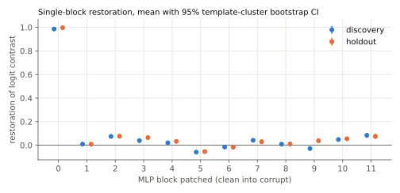
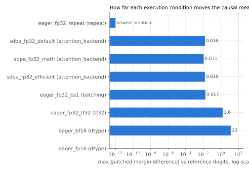
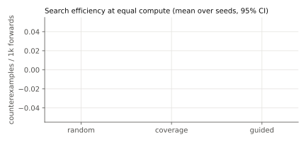

# Evidence report: `pythia160m_ioi_mlp0_extended_embedding_v1`

**Status: `inconclusive`**

- invariance mlp_channel_permutation listed in the claim was not validly tested

> In Pythia-160m on IOI with an S2-flip corruption, MLP block 0 acts as an extended token embedding. Restoring its clean output at every position carries the second-subject identity forward and restores most of the answer-minus-distractor logit contrast.

Mechanism: MLP 0 output at the S2 token encodes which name occupies that position; later attention reads it to decide which name was repeated.  
Unit: MLP block 0 output (all positions)  
Model: `EleutherAI/pythia-160m` @ `50f5173d932e8e61f858120bcb800b97af589f46`  
Scope: 16 registered IOI templates (8 discovery, 8 holdout), 40 single-token first names split 30/10, 12 places, 10 objects, both name orders (float32, backends eager, sdpa)

## Smallest contradicting experiment

Search found 0 counterexamples. None were minimized.

## Predictions

| id | kind | split | outcome | evidence |
|---|---|---|---|---|
| mean_restoration | restoration_at_least | holdout | **pass** | mean restoration CI [0.985, 1.013] >= 0.5 |
| per_case_restoration | restoration_at_least | holdout | **pass** | 0/133 cases below 0.25; rate CI high 0.028 <= 0.05 |
| strongest_block | in_top_k | holdout | **pass** | components in top-1 in 100.0% of resamples |

## Gates

| gate | ok | detail |
|---|---|---|
| model_revision_pinned | True | revision '50f5173d932e8e61f858120bcb800b97af589f46', loaded commit '50f5173d932e8e61f858120bcb800b97af589f46' |
| reference_dispatch_verified | True | ok |
| task_validity | True | valid cases per split {'discovery': 154, 'holdout': 133}, need 30 |
| identity_patch_null | True | max \|identity patch - corrupt\| = 0 |

## Denominator

| split | generated | valid | rejections (a case can have several) |
|---|---|---|---|
| discovery | 160 | 154 | clean_does_not_prefer_answer: 5, corrupt_does_not_prefer_distractor: 1 |
| holdout | 160 | 133 | clean_does_not_prefer_answer: 12, contrast_below_threshold: 5, corrupt_does_not_prefer_distractor: 14 |

## Baseline: single-block MLP patching



| split | layer | mean restoration | 95% CI | mean effect (logits) | n | templates |
|---|---|---|---|---|---|---|
| discovery | 0 | 0.986 | [0.977, 0.994] | 8.070 | 154 | 8 |
| discovery | 1 | 0.010 | [0.005, 0.013] | 0.079 | 154 | 8 |
| discovery | 2 | 0.074 | [0.058, 0.093] | 0.617 | 154 | 8 |
| discovery | 3 | 0.039 | [0.032, 0.046] | 0.325 | 154 | 8 |
| discovery | 4 | 0.021 | [0.013, 0.027] | 0.169 | 154 | 8 |
| discovery | 5 | -0.059 | [-0.070, -0.048] | -0.464 | 154 | 8 |
| discovery | 6 | -0.015 | [-0.023, -0.009] | -0.121 | 154 | 8 |
| discovery | 7 | 0.042 | [0.025, 0.058] | 0.337 | 154 | 8 |
| discovery | 8 | 0.009 | [0.002, 0.015] | 0.069 | 154 | 8 |
| discovery | 9 | -0.028 | [-0.048, -0.010] | -0.204 | 154 | 8 |
| discovery | 10 | 0.048 | [0.041, 0.056] | 0.410 | 154 | 8 |
| discovery | 11 | 0.084 | [0.065, 0.099] | 0.695 | 154 | 8 |
| holdout | 0 | 0.997 | [0.985, 1.013] | 7.382 | 133 | 8 |
| holdout | 1 | 0.009 | [0.004, 0.012] | 0.077 | 133 | 8 |
| holdout | 2 | 0.076 | [0.065, 0.090] | 0.564 | 133 | 8 |
| holdout | 3 | 0.064 | [0.049, 0.081] | 0.464 | 133 | 8 |
| holdout | 4 | 0.033 | [0.019, 0.046] | 0.240 | 133 | 8 |
| holdout | 5 | -0.054 | [-0.069, -0.037] | -0.391 | 133 | 8 |
| holdout | 6 | -0.017 | [-0.025, -0.009] | -0.107 | 133 | 8 |
| holdout | 7 | 0.030 | [0.010, 0.048] | 0.230 | 133 | 8 |
| holdout | 8 | 0.010 | [0.001, 0.017] | 0.086 | 133 | 8 |
| holdout | 9 | 0.038 | [0.020, 0.055] | 0.296 | 133 | 8 |
| holdout | 10 | 0.054 | [0.048, 0.062] | 0.409 | 133 | 8 |
| holdout | 11 | 0.075 | [0.056, 0.096] | 0.518 | 133 | 8 |

### Controls

- Identity patch (corrupt activation into corrupt run): max deviation 0.000 logits.
- Top-3 blocks selected on discovery: [0, 2, 11]. Held-out joint restoration 1.000 [0.989, 1.013], above 90% of 20 random same-size block sets.
- Claimed blocks [0] on discovery: mean restoration 0.986 vs random same-size sets mean 0.020, max 0.084 (n=11).
- Claimed blocks [0] on holdout: mean restoration 0.997 vs random same-size sets mean 0.029, max 0.076 (n=11).

## Challenge: numerical execution

Every condition changes one factor relative to the reference. Measurements use the reference's set of valid cases so the denominator never moves.



| condition | factor | observed attention | classification | max d patched margin | max d clean logit | discovery top-k | prediction flips |
|---|---|---|---|---|---|---|---|
| eager_fp32_repeat | repeat | eager_matmul_softmax | bitwise_identical | 0.000 | 0.000 | [0, 2, 11] | none |
| sdpa_fp32_default | attention_backend | efficient | exceeds_tolerance_no_decision_change | 0.016 | 0.006 | [0, 2, 11] | none |
| sdpa_fp32_math | attention_backend | math | exceeds_tolerance_no_decision_change | 0.011 | 0.005 | [0, 2, 11] | none |
| sdpa_fp32_efficient | attention_backend | efficient | exceeds_tolerance_no_decision_change | 0.016 | 0.006 | [0, 2, 11] | none |
| sdpa_fp32_flash | attention_backend | none | **not run** | probe raised: No available kernel. Aborting execution. |  |  |  |
| eager_fp32_bs1 | batching | eager_matmul_softmax | exceeds_tolerance_no_decision_change | 0.017 | 0.006 | [0, 2, 11] | none |
| eager_fp32_tf32 | tf32 | eager_matmul_softmax | exceeds_tolerance_no_decision_change | 1.623 | 1.261 | [0, 2, 11] | none |
| eager_bf16 | dtype | eager_matmul_softmax | decision_changing | 13.136 | 11.112 | [0, 3, 10] | ['mean_restoration', 'per_case_restoration']; 135 cases with zero contrast |
| eager_fp16 | dtype | eager_matmul_softmax | decision_changing | nan | nan | [0, 1, 2] | ['mean_restoration', 'per_case_restoration', 'strongest_block']; 287 cases with zero contrast |

## Challenge: function-preserving MLP channel permutation

Every MLP's hidden channels permuted (seed 1). Output parity over all positions, full vocabulary, clean and corrupt: max |d logit| 0.007, argmax agreement 1.000, gate FAILED (tolerance atol + rtol * |logit| with rtol 0.0) at atol 0.001.

**Comparisons skipped: output parity failed, the transform is not validated.** The challenge counts as not validly run, so the mlp_channel_permutation invariance stays untested.

## Challenge: counterexample search



| strategy | seeds | counterexamples / 1k forwards | 95% CI | valid proposal rate | lowest restoration reached (mean over seeds) |
|---|---|---|---|---|---|
| random | 5 | 0.000 | [0.000, 0.000] | 0.970 | 0.829 |
| coverage | 5 | 0.000 | [0.000, 0.000] | 0.980 | 0.855 |
| guided | 5 | 0.000 | [0.000, 0.000] | 0.980 | 0.798 |

The claim's per-case threshold is 0.25. The last column shows how close each strategy pushed the claim towards failing within its budget of 900 forwards per seed, which matters most when no counterexample was found.

Counterexamples are drawn from the discovery axis space only. The holdout templates and names are never searched.

## Challenge findings

| challenge | invariance | valid | contradicts | summary |
|---|---|---|---|---|
| numerical:eager_fp32_repeat | repeat | True | False | bitwise_identical; prediction flips []; top-k [0, 2, 11] -> [0, 2, 11] |
| numerical:sdpa_fp32_default | attention_backend | True | False | exceeds_tolerance_no_decision_change; prediction flips []; top-k [0, 2, 11] -> [0, 2, 11] |
| numerical:sdpa_fp32_math | attention_backend | True | False | exceeds_tolerance_no_decision_change; prediction flips []; top-k [0, 2, 11] -> [0, 2, 11] |
| numerical:sdpa_fp32_efficient | attention_backend | True | False | exceeds_tolerance_no_decision_change; prediction flips []; top-k [0, 2, 11] -> [0, 2, 11] |
| numerical:eager_fp32_bs1 | batching | True | False | exceeds_tolerance_no_decision_change; prediction flips []; top-k [0, 2, 11] -> [0, 2, 11] |
| numerical:eager_fp32_tf32 | tf32 | True | False | exceeds_tolerance_no_decision_change; prediction flips []; top-k [0, 2, 11] -> [0, 2, 11] |
| numerical:eager_bf16 | out_of_scope | True | True | decision_changing; prediction flips ['mean_restoration', 'per_case_restoration']; top-k [0, 2, 11] -> [0, 3, 10] |
| numerical:eager_fp16 | out_of_scope | True | True | decision_changing; prediction flips ['mean_restoration', 'per_case_restoration', 'strongest_block']; top-k [0, 2, 11] -> [0, 1, 2] |
| numerical:sdpa_fp32_flash | attention_backend | False | False | not run: probe raised: No available kernel. Aborting execution. |
| symmetry | mlp_channel_permutation | False | False | parity failed: max \|dlogit\| 0.00702 |
| counterexamples | counterfactual_inputs | True | False | 0 unique counterexamples (0 reproduced); no minimized counterexample generalised to a failing sub-scope |

## Limitations

- Block-level MLP patching over all positions. It localises where restoring a clean activation matters; it does not identify the algorithm, and attention heads are not tested here.
- One task family (IOI with an S2-flip corruption). A status holds only for the scope above.
- Template-cluster bootstrap with few templates gives coarse intervals. The cluster count is in the tables.
- Kernel dispatch is read from the profiler for one batch per condition and assumed stable across batches of the same shape.

## Reproduce

```bash
kerneltrace replay runs/20261101T151501Z_pythia160m_ioi_mlp0_c0789f25
```

torch 2.11.0+cu128 (CUDA 12.8), transformers 4.57.6, NVIDIA GeForce RTX 5060 Laptop GPU, driver 610.74, git 52ee56d734 (clean tree).
